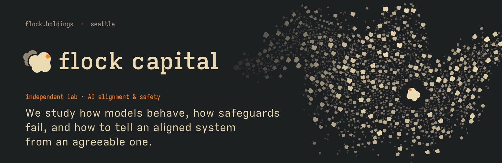
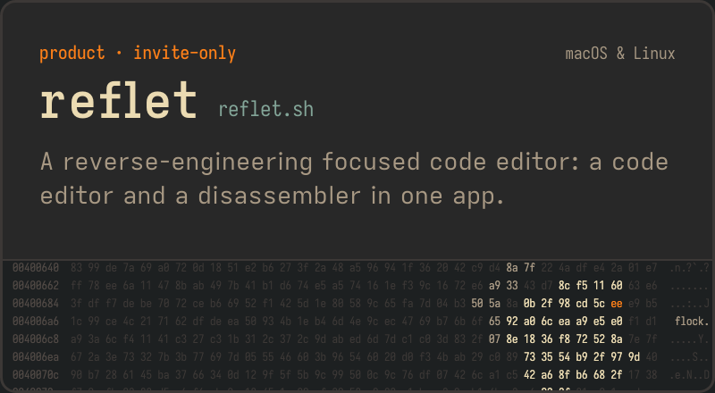
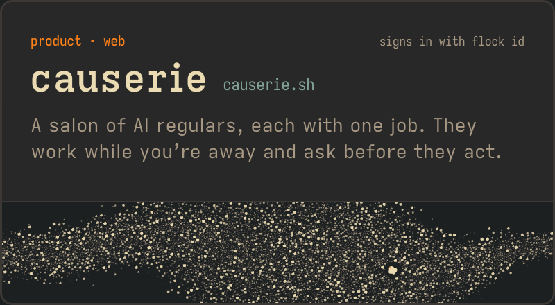
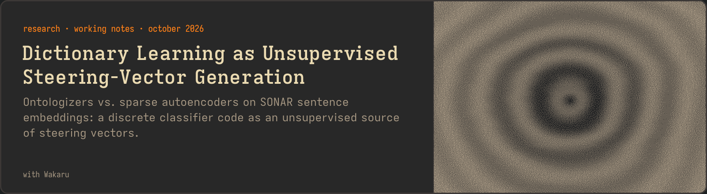
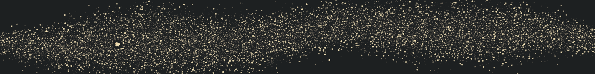

<a href="https://flock.holdings">
  <picture>
    <source media="(prefers-color-scheme: dark)" srcset="https://github.com/flockcap/.github/raw/main/profile/assets/header-dark.png">
    <source media="(prefers-color-scheme: light)" srcset="https://github.com/flockcap/.github/raw/main/profile/assets/header-light.png">
    
  </picture>
</a>

Flock Capital is an independent lab for AI alignment and safety, based in Seattle. We also build software: the tooling our research runs on, and products of our own.

### Products

<a href="https://reflet.sh"><picture><source media="(prefers-color-scheme: dark)" srcset="https://github.com/flockcap/.github/raw/main/profile/assets/card-reflet-dark.png"><source media="(prefers-color-scheme: light)" srcset="https://github.com/flockcap/.github/raw/main/profile/assets/card-reflet-light.png"></picture></a>&nbsp;<a href="https://causerie.sh"><picture><source media="(prefers-color-scheme: dark)" srcset="https://github.com/flockcap/.github/raw/main/profile/assets/card-causerie-dark.png"><source media="(prefers-color-scheme: light)" srcset="https://github.com/flockcap/.github/raw/main/profile/assets/card-causerie-light.png"></picture></a>

### Research

<a href="https://flock.holdings/research/ontologizers-vs-saes-sonar/"><picture><source media="(prefers-color-scheme: dark)" srcset="https://github.com/flockcap/.github/raw/main/profile/assets/card-research-dark.png"><source media="(prefers-color-scheme: light)" srcset="https://github.com/flockcap/.github/raw/main/profile/assets/card-research-light.png"></picture></a>

The questions we work on:

- Finding steering directions in a model's representations without supervision
- Evaluations that measure what models do, not what anyone hoped they would do
- Adversarial testing of the safeguards wrapped around models
- What agents do once they are given tools and left alone

### Open source

| | |
|:--|:--|
| [**cantrip**](https://github.com/flockcap/cantrip) | Speak plainly. Get the incantation. A keyless shell companion. |
| [**reflet-plugin-template**](https://github.com/flockcap/reflet-plugin-template) | Start a Reflet plugin: an RE example (XOR/stack-string decoder), a code example, the SDK and a release workflow. |

### Work with us

We run a small consulting practice: model evaluations, adversarial testing, software engineering and cybersecurity. Engagements are scoped, written up properly, and pay for the research. If you work on similar problems and want to compare notes, we'd like to hear from you.

**[flock.holdings](https://flock.holdings)** · **[contact@flock.holdings](mailto:contact@flock.holdings)** · **[start an engagement](https://flock.holdings/contact/)**

<picture>
  <source media="(prefers-color-scheme: dark)" srcset="https://github.com/flockcap/.github/raw/main/profile/assets/footer-dark.png">
  <source media="(prefers-color-scheme: light)" srcset="https://github.com/flockcap/.github/raw/main/profile/assets/footer-light.png">
  
</picture>

Flock Capital, LLC · Seattle, Washington · self-funded and supported by research grants
